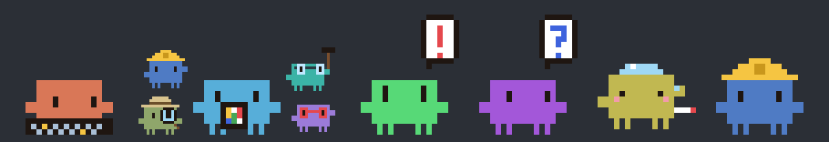
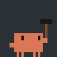
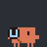
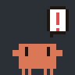
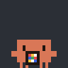
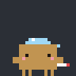
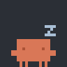
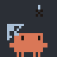
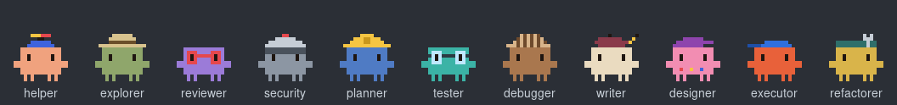
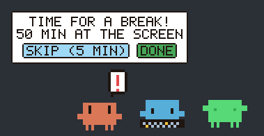

# Claudie

**Управляй сессиями, а не нянчись с ними, глядя, как они работают.**

**Первый по-настоящему полезный питомец на рабочем столе.**

[English](README.md) · **Русский**

Пиксельные Клоды на экране, по одному на каждую запущенную сессию Claude Code. Каждый показывает, чем занята его сессия: печатает, запускает команду, ищет, ждёт разрешения, задаёт вопрос, закончил или давно уснул. Сабагенты появляются мини-Клодами вокруг Клода своей сессии. Claude Code может работать на другой машине по ssh: Клоды всё равно появятся на клиенте.

<p align="center"></p>

> Claudie — неофициальный фанатский проект, не связанный с Anthropic и не одобренный ею. Claude и Clawd принадлежат Anthropic.

## Что он показывает

| | | | | |
|:-:|:-:|:-:|:-:|:-:|
| <br>Правит файлы | <br>Запускает команду | <br>Читает, ищет | <br>В интернете | <br>Думает, другие инструменты |
| <br>Ждёт разрешения | <br>Задаёт вопрос | <br>Работают сабагенты | <br>Сжимает контекст | <br>Контекст почти полон |
| <br>Готово | <br>Ошибка | <br>Остановлен Esc или отказ | <br>Коммит или пуш | <br>Упали тесты |
| <br>Свеж после сжатия | <br>Простаивает, перед сном | <br>Простаивает | <br>Простой 5 минут | <br>Простой 9 минут |
| <br>Простой 13 минут | <br>Простой 17 минут | <br>Диалог давно без ответа | <br>Соседи болтают | <br>По нему кликнули |

Это не всё: в приложении анимаций больше, и все их показывает [страница настроек](#настройки).

Claude Code не сообщает, когда разрешение одобрено, а только когда одобренный инструмент закончил работу. Поэтому `!` держится, пока идёт одобренная команда: после правки файла он гаснет сразу, после долгой сборки — только когда она закончится.

Сабагенты получают свой облик по имени: explorer, reviewer, security, planner, tester, debugger, writer, designer, executor, refactorer или helper для всех остальных. В режиме плана Клод самой сессии надевает каску планировщика. Вокруг Клода сессии помещается до шести мини-Клодов; пиксельное +N над последним считает остальных.

<p align="center"></p>

Сессии одного проекта одного цвета, у каждой свой размер. Картинки выше нарисованы тем же кодом, что рисует Клодов в приложении.

## Как пользоваться
- **Наведение** на Клода показывает его проект, чем он занят, насколько заполнен контекст, какие у него сабагенты и сколько осталось до [перерыва](#перерывы).
- **Перетаскивание** группы куда угодно: она идёт следом, врезается в края экрана и запоминает, где её оставили.
- **Клик** тыкает Клода. Три клика подряд — и он пищит.
- **Ctrl + колесо** над Клодом меняет размер.
- **Правый клик** по Клоду открывает [страницу настроек](#настройки).
- Всё остальное на экране остаётся кликабельным: мышь ловят только нарисованные пиксели.

## Как это устроено
```
 Машина с Claude Code                         Клиент
┌──────────────────────────────────┐      ┌───────────────┐
│                                  │      │               │
│  Claude Code ──хуки──┐           │      │               │
│                      ▼           │      │               │
│                claudie-daemon ───┼─────►│  Claudie.app  │
│                      ▲           │      │               │
│  транскрипты ────────┘           │      │               │
│                                  │      │               │
└──────────────────────────────────┘      └───────────────┘
                                   события, 127.0.0.1:47321
```
- **Хуки.** Claude Code сообщает демону о каждом событии через свои хуки.
- **Демон** выясняет, что делает каждая сессия. Отказ в разрешении и Esc хуков не оставляют, поэтому демон ещё читает транскрипт каждой сессии; оттуда же он узнаёт, насколько заполнен контекст. Он проверяет, жив ли процесс каждой сессии, и сохраняет сессии между перезапусками.
- **Приложение на Mac** рисует то, что сообщает демон, в прозрачном окне поверх всех остальных.
- **Расширение для GNOME** делает то же изнутри GNOME Shell: на Wayland рисовать поверх всех окон может только она сама.
- **Страницу настроек** раздаёт сам демон, поэтому она одинаково работает с любого компьютера, который до него достаёт.

| Часть | Язык | Где |
|---|---|---|
| Логика сессий, анимации, раскладка | TypeScript | `backend/core` |
| Демон | Go (выполняет TypeScript в [goja](https://github.com/dop251/goja)) | `backend/daemon` |
| Хук | POSIX sh | `backend/plugin` |
| Приложение для Mac | Swift (выполняет TypeScript в JavaScriptCore) | `frontends/macos` |
| Расширение для GNOME | TypeScript, собранный вместе с ядром и выполняемый JavaScript-движком GNOME Shell | `frontends/gnome` |
| Страница настроек | TypeScript, [Angular](https://angular.dev) | `frontends/web` |

Демон, оверлеи и страница настроек выполняют один и тот же TypeScript, поэтому логика живёт в одном месте и тестируется один раз.

## Почему эти технологии
- **Go:** один демон для всех систем, единственный статический бинарник под каждую платформу, больше ничего ставить не нужно.
- **TypeScript:** простой движок для сцены: логика пишется один раз и работает в Node, в демоне, в приложении и в браузере.
- **Swift:** нативный фронтенд для macOS.
- **Расширение GNOME Shell:** фронтенд для GNOME; на Wayland рисовать поверх всех окон может только сама оболочка.
- **Angular:** страница настроек.

## Потребление ресурсов
Claudie большую часть времени простаивает, и того, что он делает, немного.
- **Демон.** Один статический Go-бинарник, больше ничего ставить не нужно. При двух открытых сессиях (одна работает, другая простаивает) он занимал около 24 МБ памяти и потратил около 1 с процессорного времени за 15 минут, примерно 0,1% одного ядра. Он просыпается на события хуков, каждые 0,4 с читает новые строки транскрипта каждой сессии, каждые 5 с проверяет, что процессы сессий живы, и сохраняет сессии на диск в течение секунды после изменения. Без сессий оба таймера останавливаются: за минуту демон не потратил заметного процессорного времени и просыпался примерно раз в секунду, до следующего хука.
- **Оверлей.** В покое сцена обновляется 20 раз в секунду; частоте обновления дисплея он следует, только пока что-то движется. Чтобы знать, когда указатель над Клодом, приложение на Mac слушает движения мыши, а расширение для GNOME читает положение указателя на каждом обновлении. Обновление, которое ничего не меняет, ничего и не перерисовывает, а без Клодов на экране таймер останавливается, пока демон не пришлёт что-то новое. Для [напоминания о перерыве](#перерывы) он раз в 5 с читает время простоя системы, одним вызовом к GNOME Shell или macOS.
- **Claude Code.** Хуки — небольшие HTTP-запросы на `127.0.0.1`; скрипт SessionStart запускает `curl` один раз на сессию.
- **Сеть.** Всё остаётся на `127.0.0.1`; единственная загрузка — демон, один раз, из релизов этого репозитория.

## Установка и запуск
**Понадобится:** Claude Code на macOS или Linux; оверлей работает на macOS 14 или новее либо в GNOME Shell 50.

1. **Установить плагин** в Claude Code:
   ```
   /plugin marketplace add farnsworth3010/claudie
   /plugin install claudie@claudie
   ```
   Больше на стороне Claude Code ничего настраивать не нужно. Первая сессия после установки скачивает демон для текущей платформы из релизов этого репозитория, проверяет контрольную сумму и запускает его в фоне; следующие сессии находят его уже работающим.
2. **На Mac установить приложение**: скачать `Claudie-macos.zip` из [последнего релиза](https://github.com/farnsworth3010/claudie/releases/latest), распаковать, перенести `Claudie.app` в «Программы» и открыть. Приложение не нотаризовано, поэтому macOS блокирует первый запуск: откройте «Системные настройки», перейдите в Privacy & Security («Конфиденциальность и безопасность»), прокрутите вниз до сообщения о Claudie и нажмите Open Anyway («Всё равно открыть»). Или снимите метку из терминала командой `xattr -d com.apple.quarantine /Applications/Claudie.app`.

   **Чтобы собрать его из исходников**, нужны Xcode Command Line Tools (`xcode-select --install`), а для сборки сцены — [Node.js](https://nodejs.org) 25 и [pnpm](https://pnpm.io):
   ```sh
   git clone https://github.com/farnsworth3010/claudie.git && cd claudie
   pnpm install && pnpm build
   cd frontends/macos && swift run
   ```
3. **На GNOME установить расширение**: скачать `Claudie-gnome.zip` из [последнего релиза](https://github.com/farnsworth3010/claudie/releases/latest) и выполнить
   ```sh
   gnome-extensions install --force Claudie-gnome.zip
   ```
   Затем выйти из сеанса и войти снова (на Wayland GNOME подхватывает новое расширение только при входе) и включить его командой `gnome-extensions enable claudie@farnsworth3010.github.io` или в приложении «Расширения». Дальше оно запускается само при каждом входе. Нужна GNOME Shell 50.

   **Чтобы собрать его из исходников**, нужны [Node.js](https://nodejs.org) 25 и [pnpm](https://pnpm.io): `pnpm install && tools/build-gnome-extension.sh` в клоне создаёт `frontends/gnome/dist/Claudie-gnome.zip`, который ставится так же.

Если Claude Code работает на другой машине, оверлей всё равно обращается к `127.0.0.1:47321` на своём компьютере: нужно пробросить этот порт на машину с демоном, например `ssh -L 47321:127.0.0.1:47321 <host>`.

Демон пишет лог в `~/.local/state/claudie/daemon.log`. Чтобы запускать его из исходников, нужно собрать `(cd backend/daemon && go build -o bin/claudie-daemon ./src)` (нужны [Go](https://go.dev) 1.27 и сначала `pnpm build`) и запустить `backend/daemon/bin/claudie-daemon` до начала сессий.

**Обновление:** `claude plugin update claudie@claudie` или `/plugin` в сессии. Следующая сессия сама запустит новый демон вместо старого.

### Установка без релиза
Если релиз с демоном недоступен, соберите демон из исходников на машине, где работает Claude Code. Понадобятся Git, [Node.js](https://nodejs.org) 25, [pnpm](https://pnpm.io) и [Go](https://go.dev) 1.27.

1. **Собрать демон:**
   ```sh
   git clone https://github.com/farnsworth3010/claudie.git && cd claudie
   pnpm install && pnpm build
   (cd backend/daemon && go build -o bin/claudie-daemon ./src)
   ```
2. **Указать Claude Code, где демон**, например в профиле оболочки (`~/.zshrc`, `~/.bashrc`):
   ```sh
   export CLAUDIE_DAEMON="$HOME/claudie/backend/daemon/bin/claudie-daemon"
   ```
   Тогда хук плагина сам запускает этот бинарник при старте каждой сессии и ничего не скачивает. Без переменной запустите демон вручную командой `backend/daemon/bin/claudie-daemon start`, и так после каждой перезагрузки.
3. **Установить плагин** в Claude Code, как обычно:
   ```
   /plugin marketplace add farnsworth3010/claudie
   /plugin install claudie@claudie
   ```
4. **Установить оверлей** на клиенте (шаг 2 или 3 выше).

**Обновление:** `git pull`, собрать заново (`pnpm build` и `go build`), затем остановить демон командой `curl -X POST -H 'content-type: application/json' -d '{}' http://127.0.0.1:47321/quit`: собранный из исходников демон сам не заменяется. Следующая сессия запустит новый.

### Демо
`tools/demo.sh` показывает Клодов без настоящих сессий: отправляет демону выдуманные сессии во всех состояниях (печатает, команда сабагентов, ждёт разрешения и вопрос, жар от полного контекста, режим плана, коммит) и гоняет их, пока не будет нажато Ctrl+C, — тогда они уходят. Ему нужен только демон, отвечающий на `127.0.0.1:47321`, а Клоды видны на [странице настроек](#настройки) в браузере (живое превью) или, на Mac, в приложении.

**Если плагин установлен**, демон уже работает; из клона репозитория нужно запустить скрипт и открыть [http://127.0.0.1:47321/](http://127.0.0.1:47321/):
```sh
./tools/demo.sh
```
**Без плагина** сначала нужно собрать и запустить демон из клона; понадобятся [Go](https://go.dev) 1.27 и Node.js:
```sh
pnpm install && pnpm build
(cd backend/daemon && go build -o bin/claudie-daemon ./src)
backend/daemon/bin/claudie-daemon start   # демон, в фоне
./tools/demo.sh
```
**Чтобы увидеть Клодов поверх окон**, до скрипта нужно запустить приложение на Mac ([установленное](#установка-и-запуск) или собранное из клона, как ниже), а скрипт запускать во втором терминале:
```sh
(cd frontends/macos && swift run)         # приложение; оставить работать
```
Запущенный вручную демон потом можно остановить командой `curl -X POST -H 'content-type: application/json' -d '{}' http://127.0.0.1:47321/quit`.

На [странице настроек](#настройки) тоже есть симулятор: кнопки, которые заводят выдуманные сессии и проводят их по всем состояниям шаг за шагом.

### Настройки
Страница настроек открывается **правым кликом по Клоду** или в браузере по адресу [http://127.0.0.1:47321/](http://127.0.0.1:47321/); её раздаёт демон. На ней:
- настройки, они применяются сразу ко всем оверлеям;
- живое превью сессий, нарисованное тем же кодом, что и в приложении: на Клодов можно навести, перетащить их, ткнуть и поменять размер;
- симулятор выдуманных сессий: они видны и на Mac и уходят, когда страница закрывается;
- галерея всех анимаций, скинов сабагентов, стадий болезни, цветов и размеров.

Демон хранит настройки в `~/.config/claudie/settings.json` и передаёт приложению:

| Настройка | По умолчанию | Что делает |
|---|---|---|
| `size` | 4 | Экранных точек на пиксель рисунка, от 2 до 12 (меняется Ctrl + колесо) |
| `miniSize` | 0.5 | Размер мини-Клодов сабагентов относительно Клода сессии, от 0.3 до 1; масштабируются вместе с ним |
| `opacity` | 1 | От 0.2 до 1 |
| `pace` | 1 | Скорость анимаций, от 0.5 до 1.5 |
| `overFullscreen` | false | Показывать поверх полноэкранных приложений |
| `clickThrough` | false | Клики проходят сквозь Клодов к тому, что под ними; с зажатым ⌥ Option на Mac или Alt в GNOME их можно тащить, тыкать и открывать настройки |
| `overDock` | true | Клоды могут стоять на Доке; если выключено, держатся вне его области (в GNOME — вне доков и панелей, которые исключены из рабочей области) |
| `overMenuBar` | false | Клоды могут заходить на строку меню (в GNOME — на верхнюю панель) |
| `gaze` | true | Глаза следят за указателем |
| `antics` | true | Дурачится, когда диалог долго ждёт ответа |
| `neglect` | true | Паутина, цветок, снег и кости при долгом простое |
| `stroll` | false | В простое медленно прохаживается вместо сна, паутины и скелета |
| `anywhere` | false | С `wander` и без гравитации ходит по всему экрану, стоя, а не ползает по краям |
| `sleepAfter` | 45 | Секунд простоя до зевка и сна, от 10 до 600 |
| `neglectAfter` | 300 | Секунд простоя до паутины, от 60 до 3600; цветок, снег и кости — в той же пропорции |
| `patience` | 30 | Секунд ожидания диалога до выходок, от 5 до 300 |
| `inertia` | false | Брошенная группа летит дальше, замедляется и отскакивает от краёв экрана |
| `gravity` | false | Отпущенная группа падает на нижний край экрана и стоит там |
| `wander` | false | Сам ходит туда-сюда и ползает по краям экрана, повернувшись к ним ногами; с гравитацией только по нижнему краю. Пока сессия ждёт тебя, стоит на месте. Без гравитации, если поднести к краю при перетаскивании, прилипает к нему, поворачивается и ползёт дальше оттуда, где отпустил |
| `limits` | false | Часы лимитов на 5 часов и на неделю; нужна подключённая статусная строка, см. [Лимиты](#лимиты) |
| `clockInertia` | false | Брошенные часы летят дальше, замедляются и отскакивают от краёв экрана |
| `clockGravity` | false | Отпущенные часы падают на нижний край экрана |
| `breaks` | true | Клод просит сделать перерыв после долгой работы за экраном, см. [Перерывы](#перерывы) |
| `breakAfter` | 3000 | Секунд за экраном до таблички, от 300 до 7200 |
| `breakSnooze` | 300 | На сколько секунд **Skip** откладывает табличку, от 60 до 1800 |
| `breakAway` | 300 | Секунд без ввода, которые считаются перерывом, от 60 до 1800 |

### Лимиты
С включённым `limits` появляются двое пиксельных часов: `5h` — лимит на 5 часов, `wk` — недельный. Они стоят отдельно от Клодов, сначала в правом нижнем углу; их можно перетащить куда угодно, и они останутся там: не гуляют и не прилипают к краям; с `clockInertia` и `clockGravity` их можно бросать, и они падают, как группа с `inertia` и `gravity`. Клоды и часы никогда не пересекаются: группа уступает место часам, а часы, перетащенные на группу, отодвигаются. Заполненность циферблата показывает, сколько израсходовано: зелёный, жёлтый от 50%, красный от 80%. При наведении на часы видно, сколько израсходовано и когда лимит сбросится. Такие лимиты есть только у подписок Pro и Max.

Claude Code отдаёт лимиты только команде [статусной строки](https://code.claude.com/docs/en/statusline), поэтому Claudie нужно в неё встроиться. Один раз выполнить в Claude Code:
```
/claudie:limits
```
Команда ставит обёртку Claudie в `statusLine` в `~/.claude/settings.json` и сначала показывает правку. Обёртка передаёт лимиты демону, а потом запускает прежнюю статусную строку, так что та выглядит и работает как раньше; прежняя команда хранится в `~/.claude/plugins/data/claudie-claudie/statusline-inner`. Если что-то потом заменит обёртку, новая сессия об этом скажет, и `/claudie:limits` поставит её снова. `/claudie:limits off` возвращает прежнюю статусную строку.

Вручную: записать команду своей статусной строки в `statusline-inner`, а в `settings.json` поставить:
```json
"statusLine": { "type": "command", "command": "sh ~/.claude/plugins/data/claudie-claudie/claudie-statusline.sh" }
```

### Перерывы
Через `breakAfter` (50 минут) за экраном первый Клод поднимает табличку с просьбой сделать перерыв, а свободные Клоды зевают вместе с ним.

<p align="center"></p>

- **Skip** откладывает табличку на `breakSnooze` (5 минут), потом она возвращается.
- **Done** начинает отсчёт заново.
- **Если отойти**, будет то же самое: `breakAway` (5 минут) без клавиатуры и мыши считается перерывом, как и заблокированный экран или сон компьютера.
- **Наведение** на любого Клода показывает, сколько осталось до перерыва.

Оверлей читает время простоя системы, так что считается только время за этой машиной, какие бы сессии ни работали. Если на экране нет ни одного Клода, табличка ждёт первого. На странице настроек в группе Breaks есть переключатель и три интервала.

## Удаление
1. **Если подключены [часы лимитов](#лимиты)**, сначала выполнить `/claudie:limits off`: при удалении плагина удалится и обёртка, и статусная строка останется пустой.
2. **Удалить плагин** в Claude Code; заодно удалится скачанный им бинарник демона:
   ```
   /plugin uninstall claudie@claudie
   /plugin marketplace remove claudie
   ```
3. **Остановить демон:**
   ```sh
   curl -X POST -H 'content-type: application/json' -d '{}' http://127.0.0.1:47321/quit
   ```
4. **Удалить его файлы** (сессии, лог, настройки, а также сохранённую позицию и звук расширения для GNOME):
   ```sh
   rm -rf ~/.local/state/claudie ~/.config/claudie ~/.cache/claudie
   ```
5. **На Mac** закрыть приложение, стереть сохранённую позицию командой `defaults delete Claudie` и удалить `Claudie.app` (или клон, если приложение собиралось из исходников).
6. **В GNOME** удалить расширение командой `gnome-extensions uninstall claudie@farnsworth3010.github.io`.

## Планы
- **Замечать остановку до первого слова.** Esc или Ctrl+C, пока Claude ещё думает и ничего не написал, не оставляют следа: Claude Code не шлёт хук и ничего не пишет в транскрипт, поэтому Клод продолжает «думать» до следующего сообщения (или до уведомления о простое от Claude Code примерно через минуту). Остановку после начала ответа Клод уже замечает. Ждём, пока Claude Code начнёт сообщать о прерываниях.

## Разработка
`pnpm check` запускает всё: линтер и форматтер Biome, проверку типов TypeScript, тесты TypeScript, сборку, затем `gofmt`, `go vet`, тесты Go и `govulncheck`. Сообщения коммитов следуют Conventional Commits, их проверяет commitlint. Структура проекта и правила кода — в [CLAUDE.md](CLAUDE.md).

### Выпуск релиза
Релиз — это тег `vX.Y.Z`, совпадающий с `version` в `backend/plugin/.claude-plugin/plugin.json`: хук плагина качает демон из релиза с этим тегом, а CI не принимает тег, который отличается.

1. **Поднять версию** в `backend/plugin/.claude-plugin/plugin.json` (например, `0.1.0` до `0.1.1`) и закоммитить (`chore: release 0.1.1`).
2. **Влить в `main`**: плагин ставится из ветки по умолчанию.
3. **Поставить тег и запушить:**
   ```sh
   git tag v0.1.1 && git push origin v0.1.1
   ```
   CI запускает `pnpm check`, собирает демон под все платформы вместе с `SHA256SUMS`, собирает расширение для GNOME и приложение для Mac и публикует релиз со всеми файлами.
4. **Проверить релиз:** в нём должны быть `claudie-daemon-<os>-<arch>` для `linux` и `darwin` на `amd64` и `arm64`, `SHA256SUMS`, `Claudie-gnome.zip` и `Claudie-macos.zip`. Имена файлов фиксированы: на них опираются хук и инструкции по установке.

**Если CI недоступен**, то же самое делается вручную: собрать демоны командой `tools/build-daemons.sh` и расширение для GNOME командой `tools/build-gnome-extension.sh`, собрать приложение на Mac (`pnpm build && tools/build-macos-app.sh`), затем создать на GitHub релиз для этого тега и приложить `backend/daemon/bin/release/*`, `frontends/gnome/dist/Claudie-gnome.zip` и `frontends/macos/.build/app/Claudie-macos.zip`.

## Как здесь используется ИИ
Claudie делается вместе с Claude Code, агентом для программирования от Anthropic. Порядок работы записан в [CLAUDE.md](CLAUDE.md); агент читает его в начале каждой сессии.
- **Решает мейнтейнер, агент пишет и объясняет.** Архитектура, выбор языков, модель состояний и каждый компромисс — решения мейнтейнера. Агент пишет большую часть кода маленькими шагами, объясняет каждый файл и решение и ждёт одобрения перед следующим шагом.
- **Факты из экспериментов, а не догадок.** Как Claude Code на самом деле сообщает о разрешениях, Esc, сабагентах и сжатии контекста, выяснено на настоящих сессиях с записью их событий; логика состояний тестируется на этих записях.
- **Параллельные агенты и отдельное ревью.** Независимые части (анимации, Go-демон, Swift-приложение) часто пишут параллельные сабагенты по заранее согласованным интерфейсам, а отдельный агент-ревьюер ищет баги до того, как работа считается законченной.
- **Последнее слово за людьми.** Агент работает на Linux, поэтому Swift-приложение собирает и запускает на Mac мейнтейнер и сообщает о результате; все коммиты делает мейнтейнер.

## Лицензия
[MIT](LICENSE). Лицензия распространяется только на код: Claude и Clawd, талисман на спрайтах, принадлежат Anthropic.
